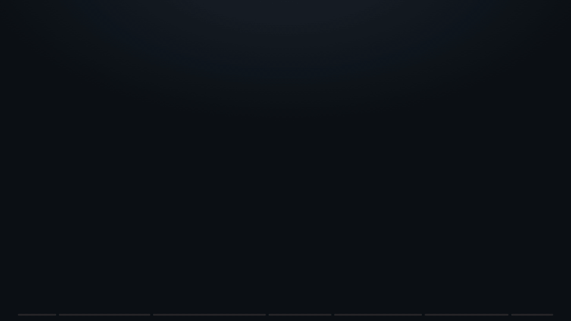
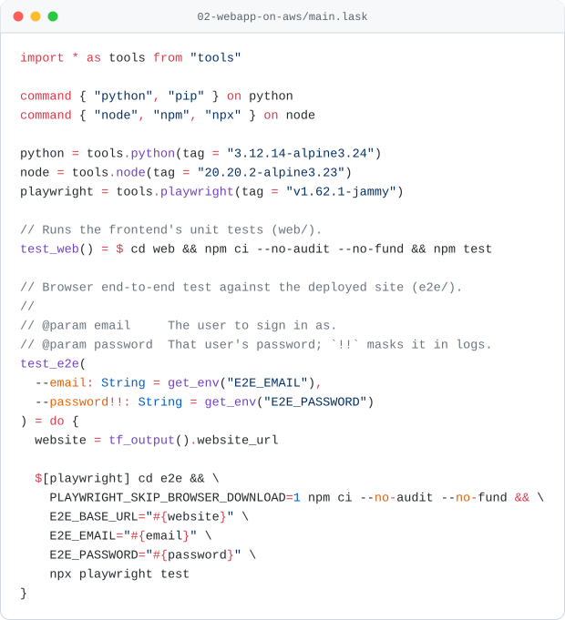

# Lask

[](https://github.com/lask-task-runner/lask/actions/workflows/test.yml)
[](https://github.com/lask-task-runner/lask/releases/latest)
[](LICENSE)
[](https://lask-task-runner.github.io/)

<div align="center">
  
  <br>
  <a href="https://lask-task-runner.github.io/">▶ Watch the full 1-minute tour on the documentation site</a>
</div>

<sub>Docker is a trademark of Docker, Inc. Other names belong to their owners; their use does not imply endorsement.</sub>

Lask (lambda + task) is a task runner with a small language behind it, giving automation what shell scripts and CI YAML never had: portability, reproducibility, and verification before anything runs.

Lask is for anyone who finds Makefiles and Taskfiles not quite enough, and Dagger too much. The first are screwdrivers from the kitchen drawer; the second, a factory floor of your own to operate — its own engine, its own SDK, a general-purpose language and its entire ecosystem. Lask is the garage in between: install Docker and Lask, and you have everything you need.

The recording above and the excerpt below come from [example/01-projects/02-webapp-on-aws](example/01-projects/02-webapp-on-aws), which builds and deploys a full AWS stack from a machine with none of its tools installed.

<div align="center">
  <picture>
    <source media="(prefers-color-scheme: dark)" srcset="doc/assets/example-dark.svg">
    
  </picture>
</div>

<p align="center"><a href="example/01-projects/02-webapp-on-aws/main.lask">See the full main.lask →</a></p>

## Why Lask

- **Approachable**: one `.lask` file is a project, in a syntax borrowed from languages you already write.
- **Verifiable**: `lask check` resolves every name, argument and type before a single command runs, and your editor shows the same errors as you type.
- **Portable**: every command runs in an environment you pin, such as `command { "go" } on #golang:1.22`, the same on your laptop and in CI.
- **Programmable**: a task is a typed function, with error handling and concurrency in the language and tasks imported across projects.
- **Runnable**: a task's signature is its command line, and its doc comment is its `--help`.
- **Secure**: secrets are masked in the log and can come from Vault, and imports are pinned by content hash.

Lask is a task runner, not a build system or a CI platform: it replaces what your CI jobs run, not the CI itself. [Why Lask](https://lask-task-runner.github.io/guide/why-lask) covers all of this, with a [comparison to make, Taskfile and Dagger](https://lask-task-runner.github.io/guide/why-lask#how-lask-compares).

## Install

```bash
$ brew tap lask-task-runner/tap
$ brew trust lask-task-runner/tap
$ brew install lask
```

Lask also needs Docker. [Installation](https://lask-task-runner.github.io/guide/installation) covers Linux, Windows, building from source, shell completion and the VS Code extension; then [Getting started](https://lask-task-runner.github.io/guide/getting-started) takes you to a first task in about five minutes.

## Documentation

The documentation is at **<https://lask-task-runner.github.io/>**, with a copy for each release:

- [Getting started](https://lask-task-runner.github.io/guide/getting-started) and [Your first real task file](https://lask-task-runner.github.io/guide/first-task-file): from installing Lask to a CI task of your own.
- [Language guide](https://lask-task-runner.github.io/language/): the whole language, one runnable topic at a time.
- [Quick Reference](https://lask-task-runner.github.io/reference/quick-reference): the language and the CLI on one page.
- [Migrating from Make](https://lask-task-runner.github.io/guide/migration/from-make) and [from GitHub Actions](https://lask-task-runner.github.io/guide/migration/from-github-actions).
- [The tools module](https://lask-task-runner.github.io/modules/tools/): the official module of ready-made environments, function by function.

The [language specification](doc/spec.md) and the [compatibility policy](doc/compatibility.md) live in this repository, and the site shows them too.

## Status

Lask is pre-1.0: features are `experimental` until 1.0, and breaking changes are still possible. See [doc/compatibility.md](doc/compatibility.md) for what `stable` will mean once released. Until then, [feedback](#feedback) shapes what becomes stable.

## Feedback

Questions, ideas and feedback of any kind are welcome in [GitHub Discussions](https://github.com/lask-task-runner/lask/discussions). Found a bug? Please open an [issue](https://github.com/lask-task-runner/lask/issues).

## Development

```bash
$ lask run test
```
